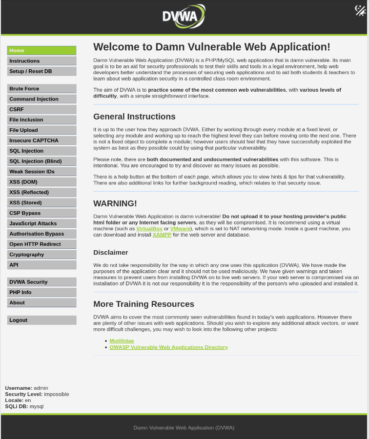

# DVWA Web Security Lab

## Overview

This project is a hands-on web application security lab built using Damn Vulnerable Web Application (DVWA) in a local Kali Linux environment. The goal is to understand common web application vulnerabilities, practice security testing techniques, and document findings in a controlled laboratory environment.

## Objectives

- Understand common web application vulnerabilities.
- Learn the fundamentals of web security testing.
- Practice identifying and analyzing security weaknesses.
- Understand how vulnerabilities can affect web applications.
- Explore mitigation techniques and secure coding practices.
- Document practical cybersecurity exercises and findings.

## Lab Environment

- Operating System: Kali Linux
- Target Application: DVWA (Damn Vulnerable Web Application)
- Web Server: Apache HTTP Server
- Server-side Language: PHP
- Database: MariaDB
- Access URL: `http://127.0.0.1/dvwa/`

## Topics to Explore

- SQL Injection (SQLi)
- Cross-Site Scripting (XSS)
- Command Injection
- File Inclusion
- File Upload Security
- Authentication and Session Management
- Input Validation and Output Encoding

## Methodology

1. Configure the laboratory environment.
2. Verify that DVWA is running correctly.
3. Study each vulnerability in an isolated environment.
4. Perform controlled security tests.
5. Record observations and results.
6. Document possible mitigations and secure coding practices.

## Project Structure

```
dvwa-web-security-lab/
├── README.md
├── screenshots/
├── notes/
│   ├── setup.md
│   └── findings.md
└── reports/
```

## Lab Evidence

The screenshot below shows the DVWA application running in the local laboratory.



## Learning Outcomes

- Web application security fundamentals
- Linux-based laboratory configuration
- Common web vulnerabilities
- Security testing methodology
- Technical documentation and reporting
- Vulnerability mitigation techniques

## Disclaimer

This repository is intended for educational purposes only. All security testing must be performed on systems owned by the tester or where explicit authorization has been granted.

DVWA is intentionally vulnerable and must be kept in a controlled local environment. It must not be exposed to the public internet.

## Project Status

Laboratory setup and database initialization have been completed. Practical security testing, findings, and technical documentation are in progress.
